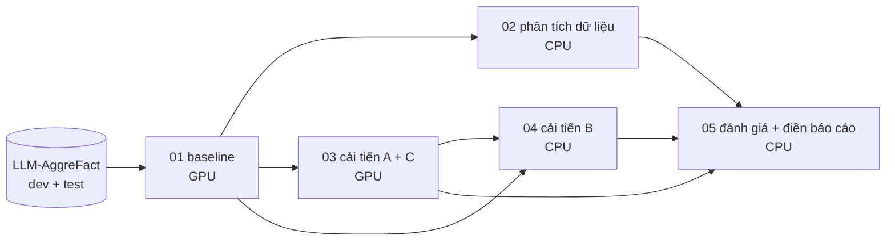

# CS114 – Cải tiến MiniCheck: chọn lọc bằng chứng theo claim + tổng hợp điểm có học

Đồ án cuối kỳ CS114 (Máy học), **Hướng 2: tối ưu lại một nghiên cứu từ bài báo khoa học**.

**Bài báo gốc:** *MiniCheck: Efficient Fact-Checking of LLMs on Grounding Documents*,
Tang, Laban, Durrett, EMNLP 2024 ([arXiv:2404.10774](https://arxiv.org/abs/2404.10774)).

- **MiniCheck làm gì:** dùng mô hình nhỏ (0.4–0.8B tham số) để kiểm tra một câu (claim) có được văn bản nguồn hỗ trợ hay không.
- **Cách nó xử lý văn bản dài:** cắt thành các đoạn ~400 token, lấy **điểm lớn nhất**, so với **ngưỡng 0.5**.
- **Đồ án thay đổi gì** (không huấn luyện lại mô hình MiniCheck):
  - **A:** chọn các câu liên quan nhất với claim, ghép thành một đoạn rồi mới chấm. Zero-shot, so thẳng được với bài báo.
  - **B:** thay "max + 0.5" bằng Logistic Regression / Gradient Boosting học trên dev. Có đánh giá leave-one-dataset-out.
  - **C (ablation):** tách claim nhiều câu, lấy min.

Chi tiết: [`docs/proposal.md`](docs/proposal.md) · Báo cáo: [`docs/report.md`](docs/report.md) ·
Tiến độ: [`docs/progress_log.md`](docs/progress_log.md) · Slide: [`docs/slides_outline.md`](docs/slides_outline.md)

## Cấu trúc

```
src/mcplus/           code dùng chung (notebook clone repo rồi import từ đây)
  chunking.py         tách câu + cắt chunk giống hệt MiniCheck
  scorer.py           FastScorer: chấm theo batch, kiểm tra khớp với MiniCheck.score gốc
  evidence.py         cải tiến A (BM25 / dense / hybrid, chọn câu theo ngân sách 1 chunk)
  features.py         đặc trưng cho cải tiến B
  aggregator.py       cải tiến B (LR / HGB, trọng số macro-BAcc, CV, LODO)
  metrics.py          BAcc, ECE, Brier, tune ngưỡng, bootstrap có cặp, McNemar
  report.py           sinh bảng Markdown + tự điền báo cáo
nb_src/*.py           mã nguồn notebook (định dạng "percent", dễ đọc diff)
notebooks/*.ipynb     notebook sinh từ nb_src bằng tools/build_notebooks.py
results/              kết quả sau khi chạy (commit vào repo), xem results/README.md
docs/                 proposal, báo cáo, nhật ký tiến độ, dàn ý slide
tests/test_core.py    kiểm thử các hàm lõi (không cần GPU)
```

## Luồng chạy



| Tuần | Notebook | Máy | Đầu vào | Đầu ra (`results/`) |
|---|---|---|---|---|
| 1 | `01_baseline` | GPU T4 | HF_TOKEN | `baseline/` |
| 2 | `02_data_analysis` | CPU | HF_TOKEN + `baseline/` | `analysis/`, `figures/` |
| 3 | `03_evidence_selection` | GPU T4 | HF_TOKEN + `baseline/` | `evidence/` |
| 4 | `04_learned_aggregation` | CPU | `baseline/` + `evidence/` | `aggregation/`, `figures/` |
| 5 | `05_final_evaluation` | CPU | tất cả ở trên | `final/` (+ `report_filled.md`) |

## Chạy trên Kaggle

1. **Hugging Face:** vào [lytang/LLM-AggreFact](https://huggingface.co/datasets/lytang/LLM-AggreFact), bấm *Agree* (dataset cần xin quyền), rồi tạo token loại *read*.
2. **Kaggle:** tạo notebook mới → *File → Import Notebook* → chọn file trong `notebooks/`.
   - *Settings*: Accelerator = GPU T4 (với notebook 01, 03), Internet = On.
   - *Add-ons → Secrets*: thêm `HF_TOKEN`, bật cho notebook.
3. **Notebook dùng output của notebook trước** (02–05): *Add Input* → chọn output của các lần chạy trước. Hoặc commit `results/` vào repo, vì notebook tự clone repo và tìm file ở cả hai nơi.
4. **Chạy:** *Save Version → Save & Run All*. Xong thì tải `/kaggle/working/results/` về, chép vào `results/` của repo và commit (bỏ các thư mục `_shards_*`).

Đổi model bằng biến `MODEL_NAME` ở đầu notebook 01, 03, 04: `deberta-v3-large` (mặc định) hoặc
`flan-t5-large`. Notebook 05 tự gom mọi model đã có kết quả.

**Colab:** chạy được y hệt. Thêm `HF_TOKEN` ở biểu tượng chìa khóa (Secrets) bên trái và bật
*Notebook access*; notebook tự đọc. Kết quả ghi vào `./results`, tải về trước khi runtime tắt.

## Chạy thử trên máy (không cần GPU)

```bash
pip install -r requirements.txt
python tests/test_core.py          # kiểm thử hàm lõi
python tools/build_notebooks.py    # sinh lại notebooks/ sau khi sửa nb_src/
```

Muốn chạy thử toàn bộ pipeline trên vài chục mẫu thì đặt `MCPLUS_SMOKE=1`, cộng thêm
`MCPLUS_LOCAL_DATA` (file parquet có cột `split, dataset, doc, claim, label`) nếu chưa có HF_TOKEN.

## Kết quả

Xem mục 4 của [`docs/report.md`](docs/report.md). Bảng được notebook 05 tự điền sau khi chạy.
